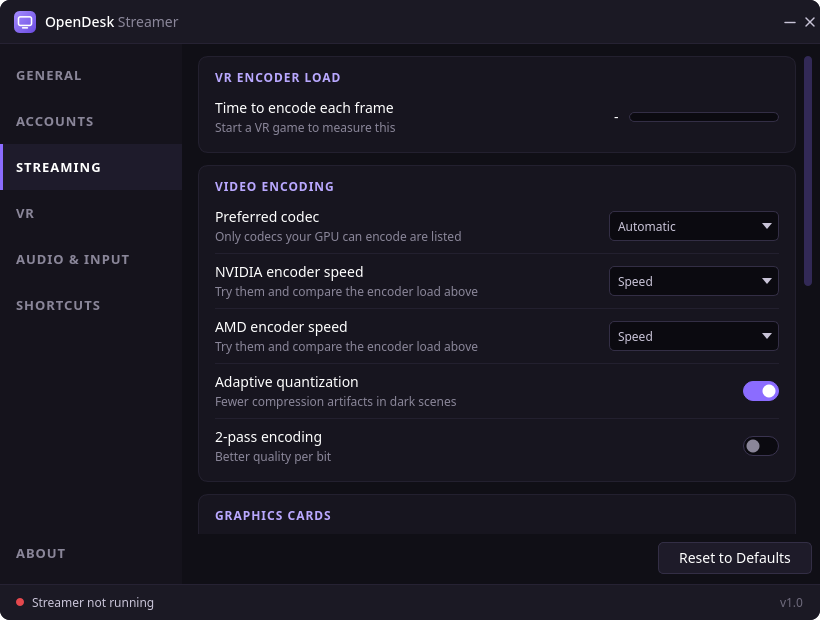
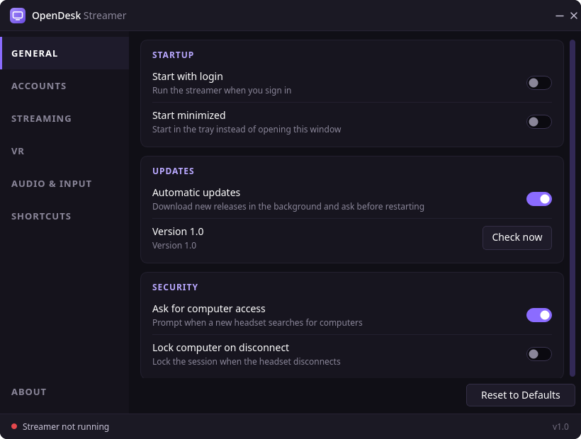
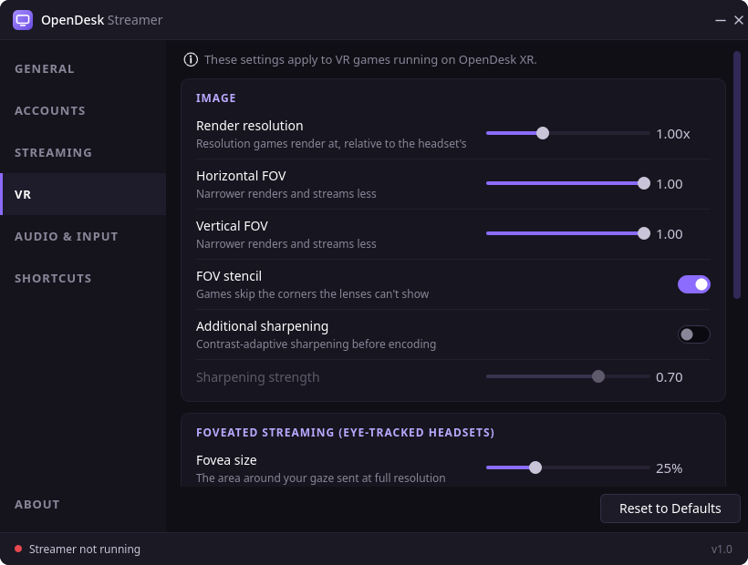
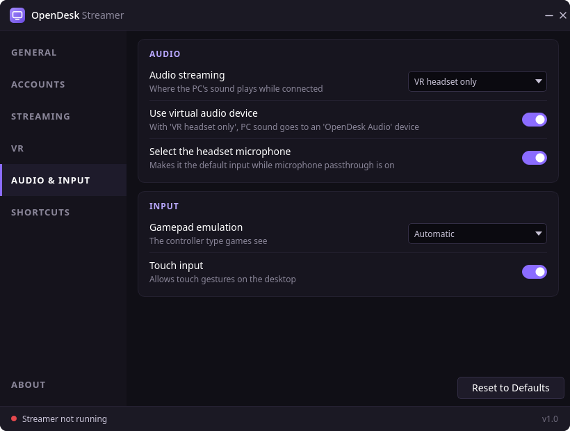
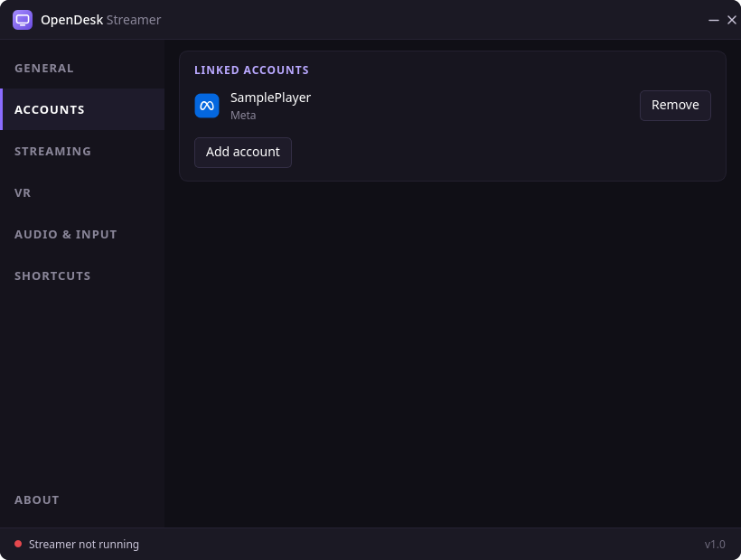

# OpenDesk

OpenDesk is an open-source PC streamer for **Linux** that lets the official **Virtual Desktop** headset app connect
to a Linux PC. Desktop streaming, VR games and audio all run natively, with no Windows machine in the picture.

**Linux only for now.**



## Please read this first

- **OpenDesk is not affiliated with, endorsed by, or supported by Virtual Desktop Inc.** Please don't send them
  support requests about it.
- **OpenDesk is not a port of Virtual Desktop's code.** It is an independent implementation written to interoperate
  with the headset app, and it contains no code or artwork from Virtual Desktop's applications.
- **You need the official Virtual Desktop app on your headset** (Quest, Pico and the other headsets it supports),
  bought from your headset's store. This project does not provide a headset app and never will: it is not an
  alternative to Virtual Desktop or a competing product. It only adds Linux as a place your existing app can connect to.

Protocol identifiers are kept only where the headset app needs them to connect.

## Download

Get the latest build from [Releases](https://github.com/lavanzazanzaman/OpenDesk/releases):

| Download | Runs on | Updates |
|---|---|---|
| `OpenDesk-Linux-x86_64.AppImage` | Any x86-64 distribution with a Vulkan GPU | Updates itself from GitHub releases |
| `OpenDesk-Linux-x86_64-native.tar.gz` | Recent Arch-based distributions | Download the new version yourself |

To run the AppImage:

```sh
chmod +x OpenDesk-Linux-x86_64.AppImage
./OpenDesk-Linux-x86_64.AppImage
```

The AppImage asks GitHub for the latest release at startup and every few hours, downloads a newer one in the
background, checks its SHA-256, and then waits for you to restart. You can turn this off under General > Updates.
On other distributions, [build from source](#build-from-source).

## What works

- Discovery and pairing on your local network
- Desktop streaming in H.264, HEVC and AV1 with hardware encoding (NVIDIA NVENC, AMD and Intel VAAPI)
- Several monitors, plus virtual monitors that only exist in the headset (KWin)
- Keyboard, mouse, touch and laser pointer input
- Desktop audio and the headset microphone
- The headset's Videos and Games tabs
- OpenXR VR games through the bundled OpenDesk XR runtime (native and Proton)
- Face, eye and body tracking, and foveated streaming on headsets that support them

## Extra features

Things OpenDesk adds on top of what the Windows streamer offers:

- **Runs natively on Linux**, including Proton games
- **[RiftLift](https://github.com/Villagers654/RiftLift) support**: Oculus PC games installed through RiftLift appear in
  the headset's Games tab and launch from there (see [Oculus games](#oculus-games-riftlift))
- **OpenVR games without SteamVR**, through the bundled [xrizer](https://github.com/Supreeeme/xrizer)
- **Your choice of graphics card**: run VR on either card, or split it so one renders the game while the other encodes
- **Live VR encoder load**: the real encode time per frame, and what each quality option costs at your resolution
- **Encoder speed choice** on both NVIDIA and AMD
- **Built-in VRChat face tracking** over OSC with adjustable mouth sensitivity, no extra programs needed
- **Larger fovea** (up to 50%), **adjustable periphery resolution** and an optional **soft fovea edge**
- **Automatic version matching**, so newer headset apps neither refuse the PC nor ask you to update it
- **Settings that match your hardware**: options your PC can't use are greyed out with an explanation

## Oculus games (RiftLift)

Oculus PC games need [RiftLift](https://github.com/Villagers654/RiftLift) installed on the same PC so OpenDesk can find
it. OpenDesk looks for the `riftlift` command on your `PATH` or in `~/.local/bin`, and for your games in
`~/.local/share/riftlift`. Use RiftLift's `.deb`, `.rpm` or AUR package, or its `install.sh`. A Flatpak isn't detected,
and neither is an AppImage unless you put it at `~/.local/bin/riftlift`.

## Not implemented

These parts of the Windows streamer are left out on purpose:

- **Media tab**: not something this project needs.
- **Remote connections**: these depend on Virtual Desktop's own online servers, which an unofficial streamer shouldn't
  connect to. OpenDesk only works on your local network or over USB.
- **Windows-only options** such as VoiceMeeter mode.

[`docs/compatibility.md`](docs/compatibility.md) lists every setting and message and what OpenDesk does with it.

## Screenshots

| | |
|---|---|
|  |  |
|  |  |

## Build from source

Install the dependencies for your distribution (Arch shown here;
[`docs/building.md`](docs/building.md) has Ubuntu, Debian, Fedora and openSUSE):

```sh
sudo pacman -S --needed base-devel cmake ninja qt6-base qt6-wayland ffmpeg libpipewire libpulse libevdev lz4 openssl \
    vulkan-icd-loader vulkan-headers shaderc mesa libglvnd wayland wayland-protocols openxr python \
    libx11 libxext libxrandr libxfixes
```

Then build and run it:

```sh
git clone https://github.com/lavanzazanzaman/OpenDesk.git
cd OpenDesk
cmake -S . -B build -G Ninja -DCMAKE_BUILD_TYPE=Release
cmake --build build
./build/streamer/opendesk-streamer
```

To install it, run `sudo cmake --install build`. Builds you make yourself don't update themselves: pull and rebuild.

## Network

Open these ports on the PC's firewall (the System check window can do this for you):

- UDP 38850: discovery
- TCP 38810-38840: messaging, data, video, audio

Settings are in `~/.config/OpenDesk/`, and the log is at `~/.cache/OpenDesk/streamer.log`.

## Headset version compatibility

The headset app refuses a streamer whose minor version is newer than its own, and asks older streamers to update.
Headset apps from 1.34.25 onward send their version when they search for computers, and by default OpenDesk reports
that version back. Older apps get 1.20.3, the lowest version the app accepts. To force a version:

```sh
OPENDESK_STREAMER_VERSION=1.34.23 opendesk-streamer
```

## Contributing

Issues and pull requests are welcome, see [CONTRIBUTING.md](CONTRIBUTING.md).

## Project layout

| Path | Contents |
|---|---|
| `streamer/` | Qt 6 GUI |
| `core/` | Native streaming engine (capture, encode, input, audio, protocol) |
| `runtime/openxr/` | OpenDesk XR OpenXR runtime, derived from [VDXR](https://github.com/mbucchia/VirtualDesktop-OpenXR) (MIT) |
| `runtime/libovr-opendesk/` | LibOVR-compatible layer over the streamer's VR interface |
| `engine/` | Python reference implementation used by the tests |
| `third_party/` | Vendored third-party code |
| `docs/` | Build and compatibility notes |

## License

OpenDesk is released under the MIT License. See [`LICENSE`](LICENSE) and
[`THIRD_PARTY_NOTICES.md`](THIRD_PARTY_NOTICES.md) for the licenses of vendored and derived components.

"Virtual Desktop" is a trademark of its owner and is used here only to say what this project works with.
